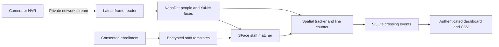

# Maggpie Vision engineering handoff

Prepared 8 October 2026 for the next developer and pilot operator. Maggpie Vision
is a Python/OpenCV showroom footfall prototype with a central server, a separate
laptop recognition demo, and an older local counting interface. The immediate
next milestone is a measured one-entrance pilot. The existing code is not evidence
of production accuracy, capacity, or successful cloud deployment.

## Current scope and decisions

The current deployment direction is **central inference**. Cameras reach the server
over a private routed network; the dashboard does not perform inference. A cloud
provider, domain, server capacity, and camera routing still need to be selected.
The former plan for a processing PC in every showroom is historical.

| Capability | Status and meaning |
|---|---|
| Person IN/OUT | Implemented as physical line-crossing events using short-lived tracks |
| Face detection | Implemented; visible faces are not unique visitor identities |
| Central staff exclusion | Implemented with consented enrollment and showroom-scoped SFace matching |
| Central reporting | Persistent daily/hourly counts, excluded staff totals, camera states, CSV; Asia/Kolkata reporting day |
| Recovery | Latest-frame queue, bounded reconnect backoff, new tracking segment after gaps, enabled-camera restore |
| Laptop demo | Webcam name/Unknown overlays, in-memory gallery, session counts; separate from central storage |
| Family or buying-party grouping | Not implemented |
| Same-day returning visitor deduplication | Not implemented |
| Verified occupancy | Not implemented; signed IN minus OUT is net flow |
| Multi-user roles and branch permissions | Not implemented; one central admin password |
| Production operations | Automated backups, retention cleanup, alerting and key migration remain work |

Longer-term business requirements include one client count per buying party and
same-day repeat exclusion. Preserve those as future requirements; the current
release counts individuals. Do not describe every unmatched person as a confirmed
customer: deliveries and other noncustomers are also possible.

Read this file and [central deployment](docs/CENTRAL_DEPLOYMENT.md) first.
[The implementation plan](docs/IMPLEMENTATION_PLAN.md) and
[discovery questionnaire](docs/REQUIREMENTS_AND_DECISIONS.md) preserve older
decisions and proposals. Their local-processing architecture is superseded.

## Architecture and code map



| Location | Responsibility |
|---|---|
| `vision/models.py` | Pinned NanoDet/YuNet download URLs and SHA-256 checks |
| `vision/detectors.py` | OpenCV DNN person detection and YuNet face detection |
| `vision/counting.py` | Spatial association, track expiry, stable-side crossing rules |
| `vision/pipeline.py` | Local source processing, overlays, CSV and summary output |
| `central/download_models.py` | Download and verify all three models including SFace |
| `central/workers.py` | Camera readers, inference threads, retry and worker lifecycle |
| `central/staff.py` | Enrollment, template encryption and staff matching |
| `central/store.py` | Camera config, event records, connection log, reports |
| `central/server.py` | HTTP API, admin session, Origin/Host checks and CSRF validation |
| `central/web/` | Central dashboard frontend |
| `demo_app.py`, `vision/demo_identity.py`, `web/demo.html` | Independent loopback recognition demo |
| `app.py`, `web_app.py`, `run.py`, `web/index.html` | Original desktop, browser and command-line interfaces |
| `deploy/` | Container, Compose, Caddy and placeholder configuration |
| `tests/` | Counting, pipeline, central service and demo tests |

Each central camera loads separate detector/matcher instances. The configured
four-camera default is a guard, not a measured capacity. Inference is CPU-based;
no GPU scheduling or distributed worker system is configured.

## Clean installation

Use Python 3.12. On Windows, from the repository root:

```powershell
py -3.12 -m venv .venv
.\.venv\Scripts\python.exe -m pip install -r requirements.txt
.\.venv\Scripts\python.exe -m central.download_models
.\.venv\Scripts\python.exe -m pip check
.\.venv\Scripts\python.exe -m unittest discover -s tests -v
```

On Linux, create the environment with `python3.12 -m venv .venv` and use
`.venv/bin/python`. For a central-only installation use `deploy/requirements.txt`
for headless OpenCV; do not install both OpenCV packages into one environment.
The desktop Tk interface additionally needs the operating system's Tk support.

Initial installation/model download needs internet access. Inference subsequently
uses local model files. The repository excludes downloaded models, camera videos,
personal photos, local output, database files, and credentials. The automated tests
use controlled inputs and do not require model downloads or a real camera.

## Central development setup

The server does not automatically load `.env` files when invoked directly with
Python. Set environment variables in the launching shell. This PowerShell example
prompts for a development password without placing it in shell history:

```powershell
$maggpiePassword = Read-Host 'Development admin password (16+ characters)' -AsSecureString
$env:MAGGPIE_ADMIN_PASSWORD = [System.Net.NetworkCredential]::new('', $maggpiePassword).Password
$env:MAGGPIE_STAFF_KEY = (& .\.venv\Scripts\python.exe -c 'from cryptography.fernet import Fernet; print(Fernet.generate_key().decode())')
$env:MAGGPIE_PUBLIC_ORIGIN = 'http://127.0.0.1:8010'
$env:MAGGPIE_DATA_DIR = Join-Path $PWD 'data'
.\.venv\Scripts\python.exe -m central.server --port 8010
```

The generated key is suitable for a new disposable development database. Preserve
the same key securely across restarts if keeping staff enrollments; generating a
replacement key will make existing templates unreadable. The key and admin
password exist in process environment variables during runtime.

Open `http://127.0.0.1:8010`. For camera testing, set an authorized stream URL in a
`MAGGPIE_CAMERA_*` variable before starting the server, then enter only that variable
name in the dashboard. The checked-in `deploy/.env.example` contains placeholders.

| Variable | Purpose |
|---|---|
| `MAGGPIE_ADMIN_PASSWORD` | Required, at least 16 characters; one shared admin |
| `MAGGPIE_STAFF_KEY` | Required Fernet key; preserve separately from database backups |
| `MAGGPIE_PUBLIC_ORIGIN` | Exact scheme/host/port, no trailing slash; HTTPS for non-loopback |
| `MAGGPIE_DATA_DIR` | Database directory; defaults to repository `data/` |
| `MAGGPIE_MAX_CAMERAS` | Maximum concurrent cameras; default 4 |
| `MAGGPIE_CAMERA_<NAME>` | Authorized RTSP/RTSPS/HTTP/HTTPS stream, resolved by server only |
| `MAGGPIE_DOMAIN` | Compose/Caddy hostname for hosted deployment |

Staff enrollment uses 1–5 clear portraits and an explicit consent confirmation.
Staff and camera showroom labels must match. Stop a camera and wait for stopped
status before changing its line, then restart and manually check both directions.

## Laptop demonstration

Run `setup_demo.bat`, create `demo_photos/PersonName/` with 1–5 consenting portraits
per person, then run `start_demo.bat`. At `http://127.0.0.1:8020`, confirm consent,
import photos, start counting and allow webcam access. Re-import after server
restart. For the first rehearsal, use one person at a time with a clear face and
full-body view crossing the configured line.

Names and templates remain in server memory. Original photos remain on disk until
the operator removes them. Each counting start resets the demo counts. It does not
enroll staff into the central service. See [demo instructions](docs/simple/06_FRIENDS_DEMO.md).

## Counting and recognition behavior

Crossings require stable observations on both sides; appearing inside a region is
not an entry. Horizontal lines use the bottom of a person box. Lost continuity or
reconnection starts a new segment rather than inventing crossings during a gap.

Staff matching requires a face associated unambiguously with one person box,
cosine similarity at least 0.50, a margin of at least 0.08 over a competing staff
identity, and two recent confirmations. Matching must still be recent at event
commit time. These are initial settings in `central/staff.py`, not calibrated site
accuracy targets. Recognition after a committed event does not reclassify it.

The central event time is frame receive/decode time, not verified camera exposure
time. Central dashboard totals persist; preview overlays show the current tracking
segment. Overlapping cameras can double-count the same crossing. Use one
authoritative counting view per entrance until deduplication is designed.

Faces may be too small, hidden, rear-facing or blurred. Tracker swaps in crowds can
affect counts and staff attribution. There is no liveness detection. Use this for
evaluated footfall analytics, not access control or employee attendance decisions.

## Data and public repository boundaries

The central SQLite database stores camera labels and secret references, crossing
events, connection state transitions, staff names/showrooms, consent timestamps,
and encrypted face templates. Camera passwords are resolved from environment
variables rather than stored in the database. Staff names and other metadata are
not encrypted by the template encryption mechanism.

Enrollment images and visitor embeddings are not persisted by the central service.
Preview frames are held in memory. Local sessions write `events.csv` and
`summary.json` under `output/`; demo names/images are not written to crossing
reports. Removing a staff entry removes active templates but does not erase
previous backups. Retention and backup deletion need an operator policy.

Keep secrets, photos, recordings, databases, local artifacts and model binaries out
of Git. `.gitignore` excludes these, including all demo folders except their public
README. Do not force-add excluded files. Third-party licenses and pinned provenance
are in [THIRD_PARTY.md](THIRD_PARTY.md). A project-wide license for original code is
still an owner decision.

## Verification at handoff

On 8 October 2026, all **33 tests passed** on the existing Windows/Python 3.12
environment. `pip check` found no broken requirements, and all three model
checksums verified. Details and limitations are recorded in
[HANDOFF_VALIDATION.md](docs/HANDOFF_VALIDATION.md).

The suite covers crossing rules, export, stop/error handling, identity ambiguity,
staff scope/deletion/encryption, report day boundaries, HTTP authentication/CSRF,
latest-frame behavior and reconnection. Test doubles isolate many behaviors; this
is not a real-camera accuracy benchmark. GitHub Actions is configured to repeat
the suite on Windows and Linux with Python 3.12.

Docker was unavailable in the handoff environment. No real showroom, live RTSP
connection, fresh dependency install, HTTPS deployment, or multi-camera capacity
benchmark was validated during this handoff. Earlier smoke-test history remains
in [VALIDATION.md](docs/VALIDATION.md) and [CENTRAL_DEPLOYMENT.md](docs/CENTRAL_DEPLOYMENT.md).

## Operator runbook

1. For hosted installation, follow [CENTRAL_DEPLOYMENT.md](docs/CENTRAL_DEPLOYMENT.md).
   Establish private camera routes first; copy `.env.example` to local `.env`, set
   real secrets/domain, then run the documented Compose command. This deploys the
   application separately from publishing its source repository.
2. At opening, check camera connection state, recent result timestamps and preview.
   Confirm the line still matches the doorway and that both directions are visible.
3. If a camera reconnects, inspect the network route, camera availability and server
   configuration. Missing time remains a counting gap. A worker error needs its
   model/database/configuration cause fixed before pressing Start again.
4. To back up simply, stop the service, copy the complete data volume, then restart.
   Record the resulting counting gap. Preserve the encryption key separately. Do
   not copy only a live SQLite main file while dropping its WAL. Test restoration
   into an isolated instance before relying on backups.
5. Before upgrading, retain the previous source revision/container and a consistent
   database backup. No migration framework currently protects against future schema
   changes; check compatibility before restoring an older application version.
6. For lost-key incidents, existing encrypted templates cannot be recovered without
   the key. Restore the corresponding secure backup or arrange fresh authorized
   enrollment into a new database. No key-rotation tool is implemented.

## Prioritized next work

| Priority | Work | Completion evidence |
|---|---|---|
| P0 | Obtain authorized representative entrance video and camera/NVR details | Manual counts, lighting/occlusion coverage, usable faces in both directions |
| P0 | Agree counting definitions and measurable acceptance targets | Separate crossing precision/recall, staff false exclusions/misses, reviewer workload |
| P0 | Select server/domain and establish private routing | Real camera reachable from container without public camera ports |
| P0 | Validate Docker/HTTPS and backup/restore | Repeatable clean install, authenticated UI, persistent counts, successful recovery |
| P1 | Evaluate CPU capacity and long-running behavior | All intended cameras active; inference latency, gaps, CPU/RAM and restart results |
| P1 | Tune detection/tracking and staff thresholds | Held-out footage results distinct from tuning data; difficult cases reported separately |
| P1 | Complete operations and access controls | Alert ownership, retention, tested backups, appropriate users/roles and audit trail |
| P2 | Revisit party grouping and same-day repeats | Agreed rules, data-handling process, ambiguity/correction workflow and separate validation |

Start with 20–30 minutes of footage for feasibility, then expand to representative
held-out conditions before sign-off. Include opposite-direction crossings, children,
groups, occlusion, lingering at the line, repeat crossings, and staff without a
front-facing view. Zero events during an outage must not be presented as zero
visitors observed with a working camera.

A broader externally sourced feasibility/market research report is still pending.
Its useful next questions are camera suitability, tracker/model comparisons under
actual CPU limits, commercial-counter event APIs, full hosting/network/support
costs, and applicable deployment/privacy requirements. The historical plan contains
references but is not a current vendor, cost or legal review.

## Suggested continuation brief

> Read HANDOFF.md and docs/HANDOFF_VALIDATION.md, then inspect the central worker,
> counting and staff-matching code. Preserve the central-server direction and keep
> individual physical crossings distinct from future group/unique-visitor metrics.
> Reproduce the 33-test baseline. The next milestone is a one-entrance pilot with
> authorized footage, manual labels, private stream connectivity, and measured
> acceptance criteria. Keep all secrets and biometric data out of the repository.
> Do not claim production readiness from controlled tests.
